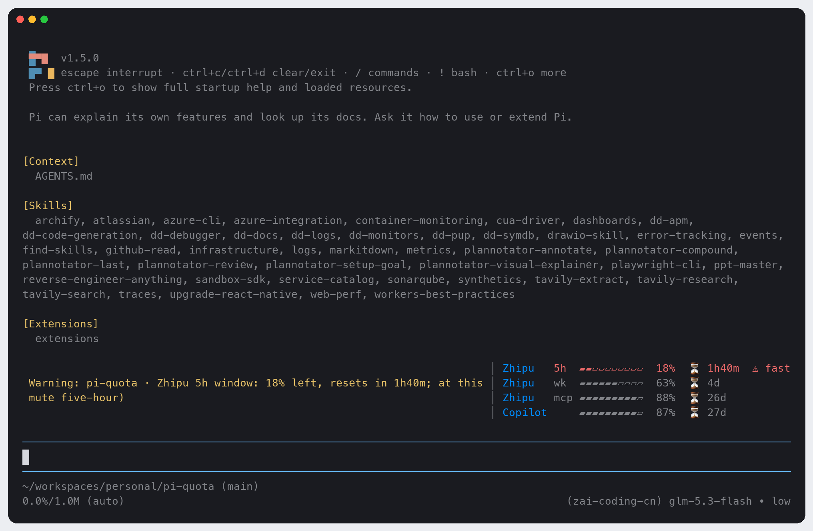
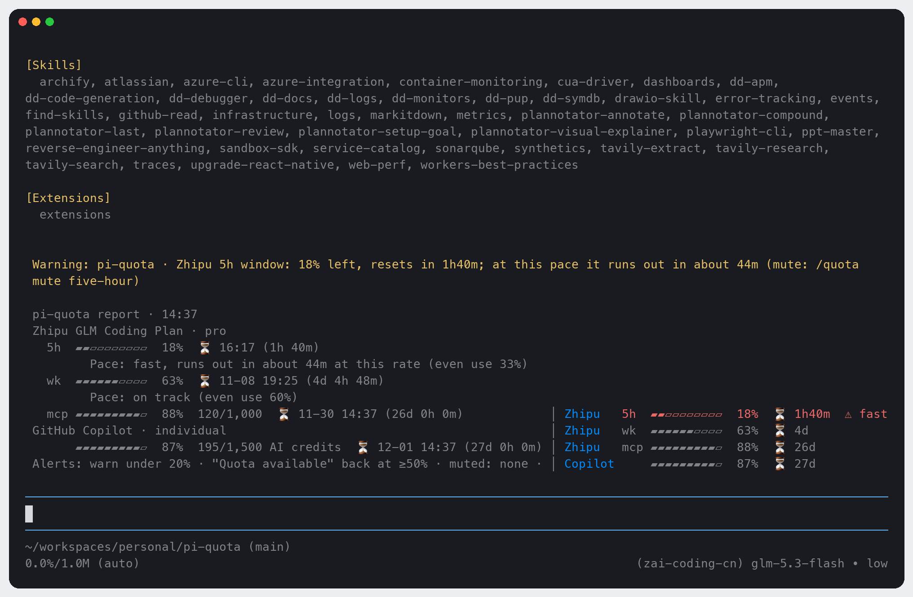
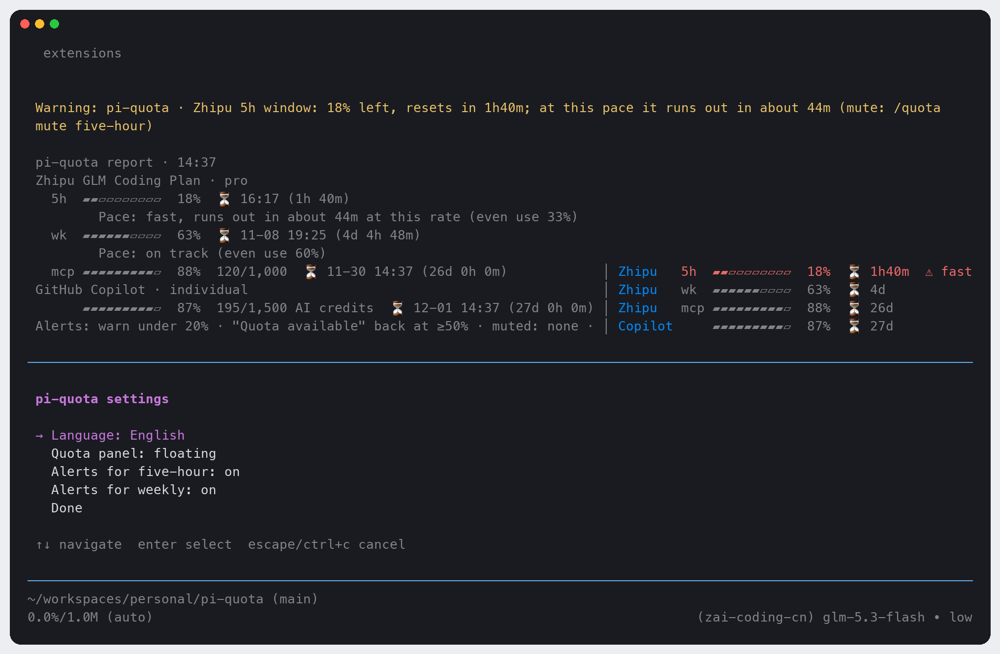

# pi-quota

English | [中文](./README.zh-CN.md)

[](https://www.npmjs.com/package/@jack-yang/pi-quota) [](./LICENSE) [](https://github.com/yangwudong/pi-quota/actions/workflows/ci.yml) 

A [pi coding agent](https://pi.dev) extension that keeps an eye on your subscription quota: the **Zhipu GLM Coding Plan (China, `zai-coding-cn`)** 5-hour, weekly and monthly MCP windows, and **GitHub Copilot** AI credits. The quota floats at the bottom right of the chat, just above the editor, without taking a row; when a window is about to run out it warns you, with the run-out time at your current pace; when a window resets it tells you "Quota available".

> Subscription quota is a hard limit: the extension watches it for you and speaks up at the right moment, instead of waiting for you to remember to check.

Ported from the opencode plugin [opencode-quota](https://github.com/slkiser/opencode-quota), keeping only what these two providers need (see [Differences from opencode-quota](#differences-from-opencode-quota)). English by default; Simplified Chinese with `/quota lang zh`.

## What it looks like

The quota panel floats at the bottom right, just above the editor, with a warning (example data). It takes no rows: the chat and the editor stay where they are:



`/quota`, the full report (shown to you only, never sent to the model):



`/quota config`, the settings menu:



- **Floating** by default: the panel sits on the chat's last rows at the right, just above the editor, and takes no rows and no keyboard input. It moves up with the editor when your input grows or a menu opens, and one row more while pi shows "Jump to latest message". When the terminal is too narrow to keep 40 columns of chat beside it (or too short), it moves above the editor until there is room again. `/quota config` → *Quota panel* switches between floating, above the editor and hidden.
- Provider names (`Zhipu`, `Copilot`) are blue (`#008AFA`); in terminals without truecolor pi uses the nearest of its 256 colors.
- Up to 3 rows per provider: 5-hour window (`5h`), weekly window (`wk`), monthly MCP allowance (`mcp`). Windows your plan doesn't have are not shown.
- Each row: a 10-cell bar, the percent left, and `⏳` with the time until the reset (`14m` / `3h12m` / `4d`).
- `⚠ fast` at the end of a row when the window is used faster than even use (once more than 10% of it has passed).
- A provider without credentials is not shown. When a credential is rejected or a request fails, its row says why in a word (`Zhipu   ✗ auth`, `Zhipu   ✗ timeout`); the other provider is unaffected.

Notifications:

```
Warning: pi-quota · Zhipu 5h window: 15% left, resets in 1h20m; at this pace it runs out in about 40m (mute: /quota mute five-hour)
✅ Quota available · Zhipu 5h window is back to 100%
```

## Install

```bash
pi install npm:@jack-yang/pi-quota     # from npm (recommended)
pi install /path/to/pi-quota           # local directory: loaded from that path, not copied
pi -e npm:@jack-yang/pi-quota          # try it for this run only, without touching settings
```

Restart pi afterwards, or run `/reload` in an open session. Update with `pi update --extensions`. Install either the npm package or a local directory, not both: with both you get two panels, and the command becomes `/quota:1` and `/quota:2`.

Use the plain path form for a local directory: `pi install npm:./pi-quota` installs but does not load.

Requirements: pi ≥ 1.5.0 (tested on 1.5.0). No runtime dependencies; the only network requests go to the two quota endpoints, `bigmodel.cn` and `api.github.com`.

## Credentials

| Provider | Where it looks | Notes |
|---|---|---|
| Zhipu `zai-coding-cn` | 1. env `ZAI_CODING_CN_API_KEY`<br>2. the `zai-coding-cn` entry of pi's `auth.json` (the API key saved by `/login zai-coding-cn`) | A `!command` key in `auth.json` is not run; set the env variable instead |
| GitHub Copilot `github-copilot` | only the `github-copilot` OAuth entry of pi's `auth.json` (`/login github-copilot`) | Uses its GitHub OAuth token (`ghu_…`), not the Copilot inference token. No API key or env substitute; GitHub Enterprise is not supported |

- `auth.json` is where pi keeps it: `PI_CODING_AGENT_DIR`, by default `~/.pi/agent`. It is read on every check, so a new `/login` applies at once.
- When the Copilot token has expired or been revoked (HTTP 401), the row shows `✗ auth` and asks you to run `/login github-copilot` again. The extension never refreshes tokens itself.
- Keys and tokens never appear in an error or a notification: every error text is redacted before it is shown.

## Commands

Type `/quota ` to see every argument with a description.

| Command | What it does |
|---|---|
| `/quota` | Full report: each window's percent left, usage, reset time (local time and countdown), pace analysis and the alert settings |
| `/quota status` | One-line summary, tightest window first (a failing provider comes first) |
| `/quota refresh` | Drop the cache and check again now |
| `/quota config` | Settings menu: language, quota panel (floating / above the editor / hidden), alerts per window; each pick applies at once |
| `/quota lang [en\|zh]` | Set the language, or pick it from a list |
| `/quota mute <five-hour\|weekly>` | Mute a window: no more warnings or "Quota available" for it (`5h` / `wk` work too) |
| `/quota unmute <five-hour\|weekly>` | Unmute it |
| `/quota hide` / `/quota show` | Hide or show the quota panel (monitoring and alerts go on while it is hidden) |

## How it monitors

- **When it checks**: at session start, after every `turn_end`, and every 60 seconds (each check restarts the timer, whichever comes first). A successful answer is cached for 60 s, so frequent turn ends do not flood the APIs; a failure is not cached and is retried on the next check. Both providers are asked in parallel, each with an 8 s timeout.
- **Warnings**: a 5-hour or weekly window **under 20%** gets one warning per window (a window is told apart by its reset time). When the current pace would use it up before the reset (and more than 10% of the window has passed), the warning adds "at this pace it runs out in about X".
- **Recovery**: a window that was under 20% and is back at **50% or more** gets `✅ Quota available`, also once per window. While you are idle the timer delivers it; no need to send another prompt.
- **No alerts**: the MCP monthly allowance (counted differently) and Copilot's monthly credits are shown in the panel only.
- Sent alerts are remembered on disk, so restarting pi, `/new` or several sessions at once never repeat the same warning.
- It does not run in subagent processes (`PI_SUBAGENT_CHILD=1`); under `pi --offline` (`PI_OFFLINE`) it makes no background requests and checks only when you run `/quota`.

## Configuration

`~/.pi/agent/pi-quota/config.json`. The commands write it for you; you can also edit it by hand:

```json
{
  "language": "en",
  "placement": "float",
  "hidden": false,
  "muted": ["five-hour"],
  "warnBelow": 20,
  "recoverAt": 50
}
```

| Field | Default | Meaning |
|---|---|---|
| `language` | `"en"` | `"en"` or `"zh"` (`/quota lang`, `/quota config`) |
| `placement` | `"float"` | `"float"`: at the bottom right, just above the editor, over the chat; `"inline"`: above the editor (`/quota config`) |
| `hidden` | `false` | Whether the panel is hidden (`/quota hide\|show`) |
| `muted` | `[]` | Muted windows (`/quota mute\|unmute`) |
| `warnBelow` | `20` | Warn when less than this percent is left, in (0, 100] |
| `recoverAt` | `50` | Say "Quota available" when a warned window is back at this percent or more |

`state.json` next to it remembers the alerts already sent (kept up to date automatically; delete it to start over).

The `/quota` command's own line in the `/` menu takes the language at load; after a language change it follows on the next `/reload` or restart. Everything else switches at once.

## Differences from opencode-quota

Kept as in the original: the whole pace model and its constants; Zhipu's window split by unit 3 / 6 / TIME_LIMIT, its parsing and error handling; the five parsing branches and request headers of Copilot's `copilot_internal/user`; countdowns that round partial minutes up.

| Original | pi-quota | Why |
|---|---|---|
| The Zhipu reply's `success:false` is not checked; a failure shows "Invalid quota data" | `success:false` / `code ≥ 400` are checked; codes 1000–1004 count as auth errors | bigmodel.cn answers a wrong key with HTTP 200 and `{"code":1000,"success":false}` |
| Zhipu gets the bare key, Copilot `token <t>` | `Bearer` for both | Both endpoints accept it (tested) |
| Copilot within its allowance is labelled with a neutral "Premium interactions" | By `token_based_billing`: true → "AI credits", false → "premium requests" | Tells new from legacy billing; the numbers are unchanged, and credits are never called PRUs |
| Copilot: PAT, billing reports, budgets, GHE, organization / enterprise billing, several logins | Personal subscription with pi's OAuth token only | Scope |
| Reset notice whenever any window resets | "Quota available" only for a window that was under 20% and is back at ≥ 50% | Tell you when it matters |
| No "under the threshold" warning | One warning when a 5h / weekly window drops under 20%, with the run-out forecast | The point of this extension |
| Snapshot file with a file lock; failures back off 1–15 min | In-memory cache: 60 s for success, failures not cached | Simpler; a failure is retried on the next check |
| Window identity from observation times | A window is known by its `resetsAt`; reset times within ±2 min are the same window | The endpoint's reset time jitters by 1 ms between calls |
| Countdown `2d5h14m` or `3.5h` | `⏳ 14m` / `⏳ 3h12m` / `⏳ 4d` in the panel, `2d 5h 14m` in the report | More compact panel |
| English only | English and Simplified Chinese (`/quota lang`) | |

Not ported: the 20+ other providers, the Web / Desktop / GUI surfaces, the settings page, the remote provider catalog, the export file, multiple accounts, session token counts.

## Known limitations

- Copilot's monthly credits and the MCP allowance are shown but never alert.
- The floating panel is drawn over the chat, not beside it: it covers the right end of the chat's last 4 lines, which is where the newest text appears; scroll or switch to *above the editor* in `/quota config` to read what is under it. It floats only in pi's fullscreen mode (the default); in `--tui-mode regular` the panel stays above the editor.
- While the panel floats, pi's `/settings` cannot switch the TUI mode (pi refuses while any overlay is open: "Close active overlays before changing TUI mode"). Run `/quota hide` first and `/quota show` after, or pick *above the editor*.
- Copilot and MCP windows have no fixed length, so they have no pace; Zhipu does not report a window start either, so it is taken as "reset time − window length".
- Sent alerts are remembered in one small file without a lock: when several pi sessions check at the very same moment, a warning may very rarely repeat once.
- Z.ai global (`zai`) is not supported.

## Development

```bash
npm test                            # node --test, no install needed (Node ≥ 22.19)
npm install && npm run typecheck    # optional: strict tsc; installs pi as the peer dependency for its types
pi -e .                             # try it in a real session
```

## License

MIT. Parts are adapted from [opencode-quota](https://github.com/slkiser/opencode-quota) (MIT); see [LICENSE](./LICENSE).
