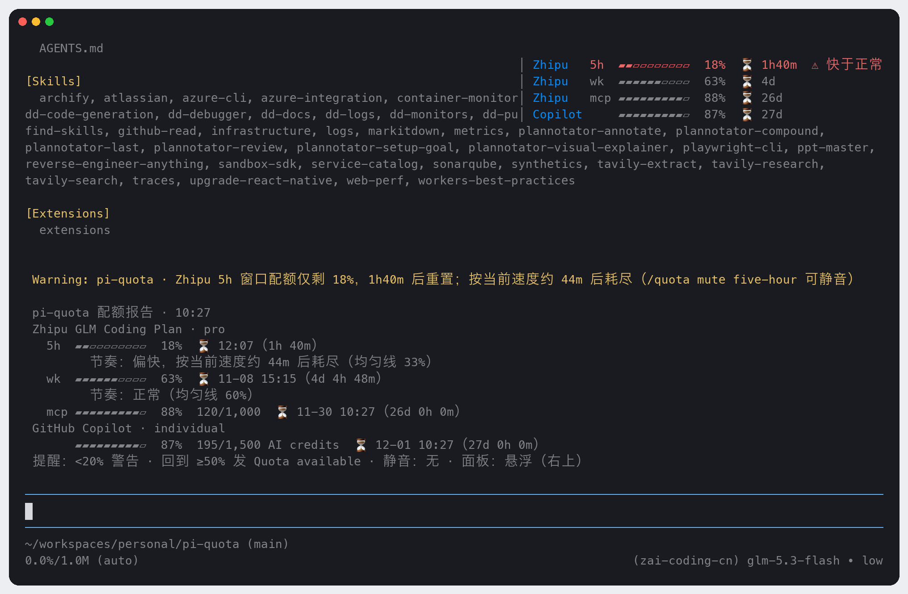
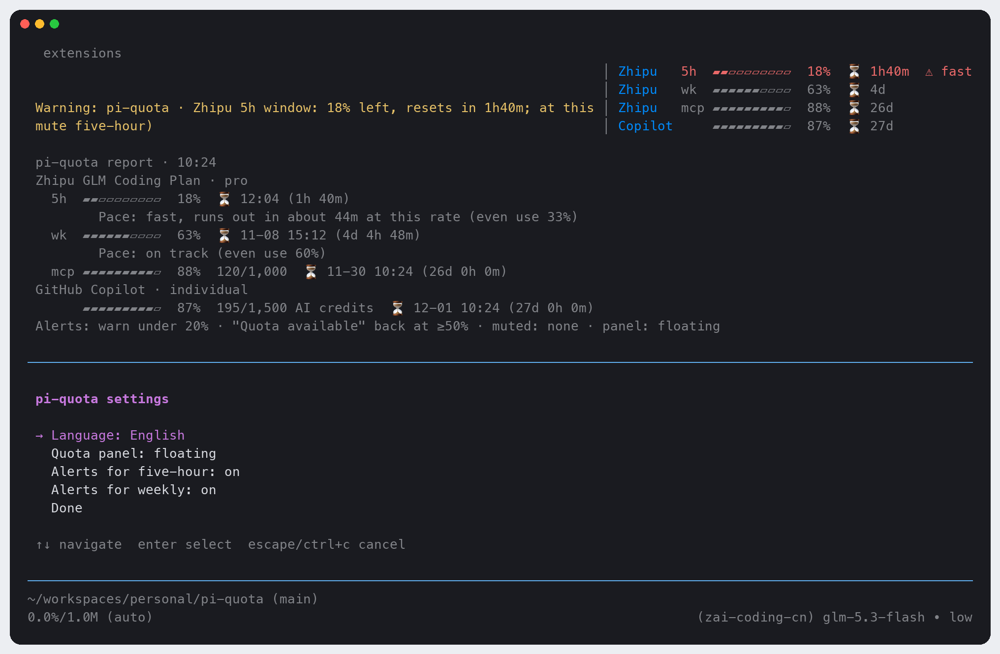

# pi-quota

[English](./README.md) | 中文

[](https://www.npmjs.com/package/@jack-yang/pi-quota) [](./LICENSE) [](https://github.com/yangwudong/pi-quota/actions/workflows/ci.yml) 

为 [pi coding agent](https://pi.dev) 盯住订阅配额的扩展：**智谱 GLM Coding Plan（国区，`zai-coding-cn`）** 的 5 小时 / 周 / MCP 月度窗口，以及 **GitHub Copilot** 的 AI credits。余量悬浮显示在屏幕右上角，不挤占对话和编辑器；窗口快用完时主动警告，并按当前速度预测耗尽时间；窗口重置恢复后通知你 “Quota available”。

> 配额是订阅制的硬约束：插件替你盯着，在关键时刻提醒，而不是等你想起来去查。

移植自 opencode 插件 [opencode-quota](https://github.com/slkiser/opencode-quota)，只移植了这两个 provider 需要的部分（见 [与 opencode-quota 的差异](#与-opencode-quota-的差异)）。

**界面默认英文**，执行 `/quota lang zh`（或在 `/quota config` 里选择）切换为简体中文，设置会保存下来。

## 显示效果

`/quota` 完整报告（中文界面，示例数据；只显示给你，不进入对话上下文）。配额面板悬浮在右上角，不占用任何行：



`/quota config` 设置菜单（英文界面）：



- **默认悬浮**：面板在右上角（对话右侧空白最多），不占行、不抢键盘输入。终端太窄（旁边留不出 40 列对话）或太矮时，自动回到编辑器上方，有空间时再浮起来。`/quota config` → 配额面板，可在 悬浮 / 编辑器上方 / 隐藏 之间切换。
- provider 名（`Zhipu`、`Copilot`）为蓝色（`#008AFA`）；不支持真彩色的终端由 pi 换成最接近的 256 色。
- 每个 provider 最多 3 行：5 小时窗口（`5h`）、周窗口（`wk`）、MCP 月度配额（`mcp`）。套餐里没有的窗口不显示。
- 每行依次是 10 格条形图、剩余百分比，`⏳` 后是距重置的倒计时（`14m` / `3h12m` / `4d`）。
- 用量快于均匀节奏、且窗口已过去 10% 以上时，行尾显示 `⚠ 快于正常`。
- 没有配置凭据的 provider 不显示。凭据有误或请求失败时，该行显示简短原因，如 `Zhipu   ✗ auth`、`Zhipu   ✗ timeout`，另一个 provider 照常显示。

主动通知：

```
Warning: pi-quota · Zhipu 5h 窗口配额仅剩 15%，1h20m 后重置；按当前速度约 40m 后耗尽（/quota mute five-hour 可静音）
✅ Quota available · Zhipu 5h 窗口已恢复至 100%
```

## 安装

```bash
pi install npm:@jack-yang/pi-quota     # 从 npm 安装（推荐）
pi install /path/to/pi-quota           # 本地目录：不复制，直接从该路径加载
pi -e npm:@jack-yang/pi-quota          # 只在本次启动试用，不写入 settings
```

安装后重启 pi，或在已打开的会话里执行 `/reload`。以后升级用 `pi update --extensions`。npm 版和本地目录版只装一个；两个都装会出现两个面板，命令也会变成 `/quota:1` 和 `/quota:2`。

本地目录请用不带 `npm:` 前缀的路径形式：`pi install npm:./pi-quota` 能装上，但加载不了。

环境要求：pi ≥ 1.5.0（已在 1.5.0 实测）。没有运行时依赖；只访问 `bigmodel.cn` 和 `api.github.com` 两个配额接口。

## 凭据

| Provider | 读取顺序 | 说明 |
|---|---|---|
| 智谱 `zai-coding-cn` | 1. 环境变量 `ZAI_CODING_CN_API_KEY`<br>2. pi 的 `auth.json` 中 `zai-coding-cn` 条目（`/login zai-coding-cn` 存入的 API key） | `auth.json` 里 `!命令` 形式的 key 不会被执行，请改用环境变量 |
| GitHub Copilot `github-copilot` | 只读 pi 的 `auth.json` 中 `github-copilot` OAuth 条目（`/login github-copilot`） | 用其中的 GitHub OAuth token（`ghu_…`），不用 Copilot 推理 token。不接受 API key 或环境变量，不支持 GitHub Enterprise |

- `auth.json` 的位置与 pi 一致：`PI_CODING_AGENT_DIR`，默认 `~/.pi/agent`。每次查询都会重新读取，`/login` 之后立即生效。
- Copilot token 过期或被吊销（HTTP 401）时显示 `✗ auth`，并提示重新执行 `/login github-copilot`。插件不会自行刷新 token。
- key 和 token 不会出现在任何错误信息或通知里：所有错误文本都先脱敏再显示。

## 命令

输入 `/quota ` 会列出全部参数及说明。

| 命令 | 作用 |
|---|---|
| `/quota` | 完整报告：各窗口余量、用量、重置时间（本地时间 + 倒计时）、节奏（pace）分析、提醒设置 |
| `/quota status` | 单行摘要，最紧张的窗口排在最前（出错的 provider 排在最前面） |
| `/quota refresh` | 清缓存，立即重查 |
| `/quota config` | 设置菜单：语言、配额面板（悬浮 / 编辑器上方 / 隐藏）、各窗口提醒；选中即生效 |
| `/quota lang [en\|zh]` | 设置语言；不带参数时弹出选择列表 |
| `/quota mute <five-hour\|weekly>` | 静音该窗口，不再发它的警告和 “Quota available”（也可写 `5h` / `wk`） |
| `/quota unmute <five-hour\|weekly>` | 取消静音 |
| `/quota hide` / `/quota show` | 隐藏 / 显示配额面板（隐藏时后台监控与提醒照常） |

## 监控与通知规则

- **何时检查**：会话开始、每次 `turn_end`，以及每 60 秒定时（每次检查后重新计时，先到先查）。成功结果缓存 60 秒，所以频繁的 `turn_end` 不会频繁请求 API；失败不缓存，下次检查重试。两个 provider 并发查询，各自 8 秒超时，互不影响。
- **警告**：5 小时窗口或周窗口剩余 **< 20%** 时发出 warning。同一个窗口周期（以重置时间区分）只警告一次。按当前速度会在重置前用完时（且窗口已过去 10% 以上），附上 “按当前速度约 X 后耗尽”。
- **恢复**：曾经低于 20% 的窗口回到 **≥ 50%** 时，发出 `✅ Quota available`，同样每个窗口只发一次。空闲时由定时检查发出，不必等下一次对话。
- **不参与提醒**：MCP 月度配额（计量方式不同）和 Copilot 月度额度只在面板里显示。
- 已发过的提醒记录在磁盘上，重启 pi、`/new` 或同时开多个会话，都不会重复发同一条警告。
- 子代理进程（`PI_SUBAGENT_CHILD=1`）里不运行；`pi --offline`（`PI_OFFLINE`）下不做后台查询，只在执行 `/quota` 时查询。

## 配置

`~/.pi/agent/pi-quota/config.json`。命令会自动写入，也可以手动编辑：

```json
{
  "language": "zh",
  "placement": "float",
  "hidden": false,
  "muted": ["five-hour"],
  "warnBelow": 20,
  "recoverAt": 50
}
```

| 字段 | 默认 | 含义 |
|---|---|---|
| `language` | `"en"` | `"en"` 或 `"zh"`（`/quota lang`、`/quota config`） |
| `placement` | `"float"` | `"float"`：右上角悬浮；`"inline"`：编辑器上方（`/quota config`） |
| `hidden` | `false` | 面板是否隐藏（`/quota hide\|show`） |
| `muted` | `[]` | 已静音的窗口（`/quota mute\|unmute`） |
| `warnBelow` | `20` | 剩余低于这个百分比时警告，取值 (0, 100] |
| `recoverAt` | `50` | 警告过的窗口回到这个百分比及以上时，发 Quota available |

同目录的 `state.json` 记录已发过的提醒（自动维护；删除即可重置）。

`/` 菜单里 `/quota` 命令本身的那一行说明在加载时确定语言，切换语言后要 `/reload` 或重启才更新；其余内容（面板、通知、报告、参数说明）立即切换。

## 与 opencode-quota 的差异

照抄的部分：pace 预测的全部逻辑和常量；智谱按 unit 3 / 6 / TIME_LIMIT 分窗口、解析和错误处理；Copilot `copilot_internal/user` 的五个解析分支和请求头；倒计时的分钟向上取整。

| 原版 | 本扩展 | 原因 |
|---|---|---|
| 智谱接口不检查 `success:false`，失败时显示 “Invalid quota data” | 检查 `success:false` / `code ≥ 400`，1000–1004 归为 auth | bigmodel.cn 对错误 key 返回 HTTP 200 加 `{"code":1000,"success":false}` |
| 智谱发不带前缀的 key，Copilot 用 `token <t>` | 都用 `Bearer` | 两个接口实测都接受 |
| Copilot 未超额时单位标为中性的 “Premium interactions” | 按 `token_based_billing`：true 为 “AI credits”，false 为 “premium requests” | 区分新计费和旧计费；数值计算不变，不会把 credits 标成 PRU |
| Copilot 支持 PAT、账单报表、预算、GHE、组织/企业计费、多账号 | 只支持个人订阅 + pi 的 OAuth token | 范围裁剪 |
| Reset notice：任意窗口重置都可以通知 | 窗口曾低于 20%、又回到 ≥ 50% 时才发 “Quota available” | 只在真正可用时提醒 |
| 没有 “低于阈值” 警告 | 5h / 周窗口低于 20% 时警告一次，附耗尽预测 | 本扩展的核心功能 |
| 快照文件 + 文件锁，失败按 1–15 min 退避 | 内存缓存：成功 60 s、失败不缓存 | 更简单，失败下次检查即重试 |
| 窗口身份按观测时间判定 | 以 `resetsAt` 为窗口标识，相差 ±2 分钟视为同一窗口 | 实测接口的重置时间会抖动 1 ms |
| 倒计时 `2d5h14m` 或 `3.5h` | 面板用 `⏳ 14m` / `⏳ 3h12m` / `⏳ 4d`，报告用 `2d 5h 14m` | 面板更紧凑 |
| 只有英文 | 英文与简体中文（`/quota lang`） | |

未移植：其余 20 多个 provider、Web / Desktop / GUI、设置页、远程 provider 目录、导出文件、多账号、会话 token 统计。

## 已知限制

- Copilot 月度额度和 MCP 只显示、不提醒。
- 悬浮面板画在对话上层，会盖住伸到右上角的长行末尾；不喜欢可在 `/quota config` 里改为“编辑器上方”。只在 pi 的全屏模式（默认）下悬浮；`--tui-mode regular` 时面板在编辑器上方。
- Copilot 和 MCP 没有固定的窗口长度，所以不计算节奏（pace）；智谱也不返回窗口起点，起点用 “重置时间 − 窗口长度” 推算。
- 已发提醒的记录是一个小文件，读写时不加锁：多个 pi 会话恰好同时检查时，有极小概率重复一次提醒。
- 不支持 Z.ai 国际版（`zai`）。

## 开发

```bash
npm test                            # node --test，不需要安装依赖（Node ≥ 22.19）
npm install && npm run typecheck    # 可选：tsc 严格检查，会装上 pi 作为 peer 依赖以获得类型
pi -e .                             # 在真实会话中试用
```

## 许可证

MIT。部分代码改编自 [opencode-quota](https://github.com/slkiser/opencode-quota)（MIT），见 [LICENSE](./LICENSE)。
